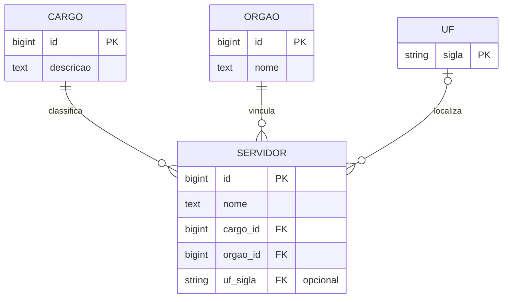

# Modelo do banco de dados

## Escopo

Este modelo organiza os campos `nome`, `cargo`, `orgao` e `uf` definidos no [mapeamento dos campos](./mapeamento-campos.md). A entidade `servidor` representa o registro de uma pessoa proveniente de qualquer um dos dois conjuntos analisados.

Os identificadores internos existem somente para estabelecer os relacionamentos. Nenhum outro dado pessoal ou funcional das fontes faz parte deste modelo.

## Modelo conceitual

## Estrutura lógica

### `servidor`

| Campo | Papel | Obrigatoriedade |
|---|---|---|
| `id` | Identificador interno do registro | Obrigatório |
| `nome` | Nome da pessoa | Obrigatório |
| `cargo_id` | Referência ao cargo | Obrigatório |
| `orgao_id` | Referência ao órgão | Obrigatório |
| `uf_sigla` | Referência à sigla da UF | Opcional |

### `cargo`

| Campo | Papel | Obrigatoriedade |
|---|---|---|
| `id` | Identificador interno do cargo | Obrigatório |
| `descricao` | Nome ou descrição do cargo | Obrigatório |

### `orgao`

| Campo | Papel | Obrigatoriedade |
|---|---|---|
| `id` | Identificador interno do órgão | Obrigatório |
| `nome` | Nome ou denominação do órgão | Obrigatório |

### `uf`

| Campo | Papel | Obrigatoriedade |
|---|---|---|
| `sigla` | Sigla da unidade federativa e chave da entidade | Obrigatório |

## Relacionamentos

- Cada servidor está relacionado a exatamente um cargo; um cargo pode estar relacionado a vários servidores.
- Cada servidor está relacionado a exatamente um órgão; um órgão pode estar relacionado a vários servidores.
- Cada servidor pode estar relacionado a nenhuma ou a uma UF; uma UF pode estar relacionada a vários servidores.
- A UF permanece ausente nos registros de Aposentados, pois o conjunto não fornece esse campo. O valor não será inferido de outros dados.

## Correspondência com as fontes

| Conjunto | `servidor.nome` | `cargo.descricao` | `orgao.nome` | `uf.sigla` |
|---|---|---|---|---|
| Aposentados | `Nome` | `Cargo` | `Nome do órgão` | Ausente |
| Carreiras/Cargos | `Nome` | `Descrição do Cargo/Emprego` | `Denominação do Órgão de atuação` | `UF da UPAG de vinculação` |
