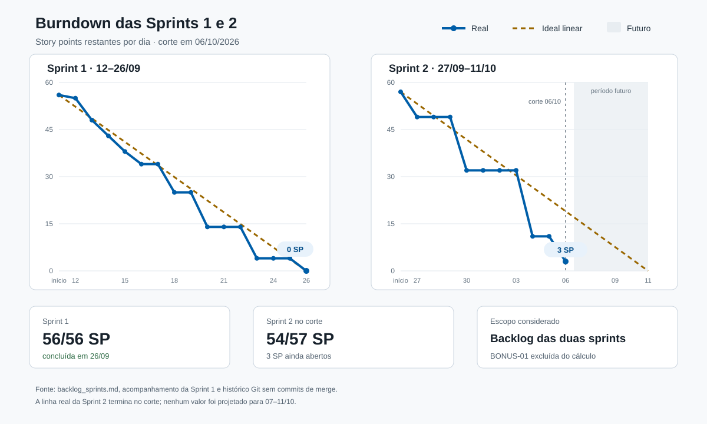

# Relatório final do projeto

> Documento em consolidação. O corte desta versão é 06/10/2026. As seções
> explicitamente marcadas como pendentes dependem do encerramento da Sprint 2 e
> não são apresentadas como concluídas.

## 1. Identificação

- Disciplina: [preencher]
- Turma: [preencher]
- Integrantes: Pedro, Marcos e Alex
- Período planejado de execução: 12/09/2026 a 12/10/2026
- Prazo de entrega: 13/10/2026

## 2. Objetivo

Apresentar o desenvolvimento da aplicação full stack para consulta de informações públicas de servidores ativos e aposentados do Poder Executivo Federal, incluindo organização da equipe, decisões técnicas, validações e resultados.

## 3. Equipe e divisão de responsabilidades

| Integrante | Responsabilidades principais |
|---|---|
| Pedro | Liderança técnica, infraestrutura, QA e documentação de gestão |
| Marcos | Banco de dados e backend |
| Alex | Frontend |

Até o corte, a divisão efetivamente entregue foi:

| Integrante | Sprint 1 | Sprint 2 concluída até 06/10/2026 |
|---|---|---|
| Pedro | `INF-01` a `INF-08`, `QA-01`, `QA-02`, `LID-01` e `LID-02` | `INF-09` a `INF-12`, `QA-03` a `QA-06`, `LID-03` e `LID-04` |
| Marcos | `BD-01` a `BD-08` e `BACK-01` a `BACK-06` | `BACK-07` a `BACK-15` e `BD-09` |
| Alex | `FRONT-01` a `FRONT-10` | `FRONT-11` a `FRONT-20` |

Permanecem fora deste corte as atividades ainda não concluídas da Sprint 2:
`LID-05` e `LID-06`, de Pedro. A atividade opcional `BONUS-01` não integra a
carga planejada das sprints e não foi iniciada.

## 4. Metodologia e organização das sprints

Descrever:

- organização do backlog e do quadro Kanban;
- duração e objetivo de cada sprint;
- critérios de priorização e Story Points;
- fluxo de branches, commits e Pull Requests;
- forma de acompanhamento diário.

## 5. Arquitetura e execução

Documentar:

- containers de PostgreSQL, backend e frontend;
- comunicação entre os serviços;
- tecnologias utilizadas;
- estrutura das principais pastas;
- comando de inicialização a partir da raiz;
- variáveis de ambiente necessárias, sem expor credenciais.

## 6. Tratamento e organização dos dados

Registrar:

- fontes públicas utilizadas;
- campos selecionados a partir dos dicionários;
- limpeza e tratamento realizados;
- modelo relacional e importação;
- contagens reconciliadas;
- índices e busca por similaridade.

## 7. Funcionalidades implementadas

### 7.1 Backend

[Preencher no fechamento com os endpoints e comportamentos realmente validados.]

### 7.2 Frontend

[Preencher no fechamento com as buscas, paginação e estados realmente integrados à API.]

### 7.3 Comportamento sob carga

Em 04/10/2026, a API e o PostgreSQL foram executados pela composição Docker do projeto. O banco de teste recebeu 100.000 servidores sintéticos, gerados com `generate_series(1, 100000)`, todos associados a um cargo, um órgão e à UF RS. A carga usou a busca `GET /api/servidores?similar=Servidor&limit=100`, que percorre o caminho completo entre API e banco. O backend estava configurado com um processo Gunicorn, quatro threads, limite de duas buscas simultâneas e timeout SQL de 2.000 ms.

No cenário de capacidade, foram realizadas 20 requisições com concorrência 2. Todas retornaram HTTP 200, sem erro de transporte. A execução durou 2,921 s, com vazão de 6,85 requisições por segundo, latência mediana de 276,08 ms, p95 de 367,76 ms e máxima de 378,41 ms. Após a carga, o endpoint de saúde respondeu HTTP 200 em 23,34 ms.

No cenário de sobrecarga, foram realizadas 200 requisições com concorrência 32. Duas buscas retornaram HTTP 200 e 198 foram rejeitadas com HTTP 429 e a mensagem JSON `limite de buscas simultaneas excedido`. Não houve erro de transporte nem status inesperado. As rejeições tiveram latência mediana de 34,12 ms e p95 de 43,66 ms; as duas buscas aceitas concluíram entre 363,25 ms e 364,60 ms. Após a carga, o endpoint de saúde respondeu HTTP 200 em 2,78 ms. O serviço permaneceu disponível e o excedente falhou de forma controlada, atendendo ao critério do teste.

Os cenários podem ser repetidos sem dependências adicionais:

```powershell
python tests/load_test.py "http://localhost:8000/api/servidores?similar=Servidor&limit=100" --requests 20 --concurrency 2 --timeout 10
python tests/load_test.py "http://localhost:8000/api/servidores?similar=Servidor&limit=100" --requests 200 --concurrency 32 --timeout 10
```

Os resultados completos estão em [teste-carga-capacidade-2026-10-04.json](./evidencias/teste-carga-capacidade-2026-10-04.json) e [teste-carga-2026-10-04.json](./evidencias/teste-carga-2026-10-04.json).

## 8. Divisão das tasks e histórico de commits

### 8.1 Critério de apuração

O histórico abaixo foi conferido na linha integrada de `dev` até o commit
`50259be`, sem merges, e nos commits `24a866c`, `0a28f98` e `6ab7768`,
produzidos em 06/10/2026 nas branches das tasks em fechamento. Foram usados a
data, o autor e a mensagem registrados em cada commit. A atividade
`INF-02/PROJ-4`, concluída no Jira sem alteração de código, foi mantida no
registro diário com essa ressalva. `LID-03/PROJ-47` corresponde à consolidação
desta seção e, por isso, aparece no corte depois do histórico-base auditado.

A data do commit indica quando a evidência entrou no histórico Git. Ela não é
usada para afirmar horas trabalhadas nem atividades que não produziram commit.
O acompanhamento detalhado da primeira sprint está em
[acompanhamento-sprint-1.md](./acompanhamento-sprint-1.md).

### 8.2 Registro diário

#### Sprint 1

| Data | Pedro | Marcos | Alex |
|---|---|---|---|
| 12/09 | `INF-01/PROJ-3` | — | — |
| 13/09 | `INF-02/PROJ-4` (gestão, sem commit) | `BD-01/PROJ-15`, `BD-02/PROJ-16` | `FRONT-01/PROJ-29`, `FRONT-02/PROJ-30` |
| 14/09 | `INF-03/PROJ-5` | `BD-03/PROJ-17` | `FRONT-03/PROJ-31` |
| 15/09 | `INF-04/PROJ-6` | `BD-04/PROJ-18` | `FRONT-04/PROJ-32` |
| 16/09 | `INF-05/PROJ-7` | `BD-05/PROJ-19` | `FRONT-05/PROJ-33` |
| 17/09 | Sem entrega integrada | Sem entrega integrada | Sem entrega integrada |
| 18/09 | `INF-06/PROJ-8`, `INF-07/PROJ-9` | `BD-06/PROJ-20` | `FRONT-06/PROJ-34`, `FRONT-07/PROJ-35` |
| 19/09 | Sem entrega integrada | Sem entrega integrada | Sem entrega integrada |
| 20/09 | `INF-08/PROJ-10`, `QA-01/PROJ-11` | `BD-07/PROJ-21`, `BD-08/PROJ-22`, `BACK-01/PROJ-23` | `FRONT-08/PROJ-36`, `FRONT-09/PROJ-37` |
| 21/09 | Sem entrega integrada | Sem entrega integrada | Sem entrega integrada |
| 22/09 | Sem entrega integrada | Sem entrega integrada | Sem entrega integrada |
| 23/09 | `QA-02/PROJ-12`, `LID-02/PROJ-14`; atualização de `LID-01/PROJ-13` | `BACK-02/PROJ-24`, `BACK-03/PROJ-25`, `BACK-04/PROJ-26` | `FRONT-10/PROJ-38` |
| 24/09 | Sem entrega integrada | Sem entrega integrada | Sem entrega integrada |
| 25/09 | Sem entrega integrada | Sem entrega integrada | Sem entrega integrada |
| 26/09 | conclusão de `LID-01/PROJ-13` | `BACK-05/PROJ-27`, `BACK-06/PROJ-28` | Sem entrega integrada |

#### Sprint 2 até 06/10/2026

| Data | Pedro | Marcos | Alex |
|---|---|---|---|
| 27/09 | `INF-09/PROJ-39` | `BACK-07/PROJ-51` | `FRONT-11/PROJ-61`, `FRONT-12/PROJ-62` |
| 28/09 | Sem entrega integrada | Sem entrega integrada | Sem entrega integrada |
| 29/09 | Sem entrega integrada | Sem entrega integrada | Sem entrega integrada |
| 30/09 | `INF-10/PROJ-40`, `INF-11/PROJ-41`, `INF-12/PROJ-42` | `BACK-08/PROJ-52`, `BACK-09/PROJ-53`, `BACK-10/PROJ-54` | `FRONT-13/PROJ-63`, `FRONT-14/PROJ-64`, `FRONT-15/PROJ-65` |
| 01/10 | Sem entrega integrada | Sem entrega integrada | Sem entrega integrada |
| 02/10 | Sem entrega integrada | Sem entrega integrada | Sem entrega integrada |
| 03/10 | Sem entrega integrada | Sem entrega integrada | Sem entrega integrada |
| 04/10 | `QA-03/PROJ-43`, `QA-04/PROJ-44`, `QA-05/PROJ-45`, `QA-06/PROJ-46` | `BACK-11/PROJ-55`, `BACK-12/PROJ-56`, `BD-09/PROJ-57`, `BACK-13/PROJ-58` | `FRONT-16/PROJ-66`, `FRONT-17/PROJ-67`, `FRONT-18/PROJ-68`, `FRONT-19/PROJ-69` |
| 05/10 | Sem entrega integrada | Sem entrega integrada | Sem entrega integrada |
| 06/10 | `LID-03/PROJ-47`, `LID-04/PROJ-48` | `BACK-14/PROJ-59`, `BACK-15/PROJ-60` | `FRONT-20/PROJ-70` |

### 8.3 Histórico de commits por integrante

#### Pedro

| Data | Task/Jira | Commit(s) | Resultado registrado |
|---|---|---|---|
| 12/09 | `INF-01/PROJ-3` | `82574ee`, `0a50fb5` | estrutura inicial ajustada para a raiz |
| 14/09 | `INF-03/PROJ-5` | `c8395e6` | composição inicial criada |
| 15/09 | `INF-04/PROJ-6` | `9785ee7` | imagem do banco criada |
| 16/09 | `INF-05/PROJ-7` | `e4be7c3` | imagem do backend criada |
| 18/09 | `INF-06/PROJ-8` | `580e9ef` | imagem do frontend criada |
| 18/09 | `INF-07/PROJ-9` | `3baff68` | orquestração dos containers validada |
| 20/09 | `INF-08/PROJ-10` | `493c300` | variáveis de ambiente configuradas |
| 20/09 | `QA-01/PROJ-11` | `edf7e9d` | plano de testes da API definido |
| 23/09 | `QA-02/PROJ-12` | `b12a706` | casos de SQL injection definidos |
| 23 e 26/09 | `LID-01/PROJ-13` | `79ef587`, `5236647` | acompanhamento da Sprint 1 registrado e encerrado |
| 23/09 | `LID-02/PROJ-14` | `26cd934` | estrutura do relatório final criada |
| 27/09 | `INF-09/PROJ-39` | `467b7a3` | aplicação integrada à composição |
| 30/09 | `INF-10/PROJ-40` | `fcc9fb3` | healthchecks e reinício configurados |
| 30/09 | `INF-11/PROJ-41` | `555a6a3` | buscas simultâneas limitadas |
| 30/09 | `INF-12/PROJ-42` | `dd80b71` | timeout aplicado às consultas |
| 04/10 | `QA-03/PROJ-43` | `1274a0d` | teste de carga executado |
| 04/10 | `QA-04/PROJ-44` | `569da1f` | resultados e limitações da carga registrados |
| 04/10 | `QA-05/PROJ-45` | `98f891d` | cenários de erro executados |
| 04/10 | `QA-06/PROJ-46` | `49fe3e6` | proteção contra SQL injection validada |
| 06/10 | `LID-03/PROJ-47` | `3acd6e5` | divisão das tasks e histórico de commits consolidados |
| 06/10 | `LID-04/PROJ-48` | este commit | burndown das duas sprints incluído |

`INF-02/PROJ-4` foi a organização do backlog e do quadro no Jira, sem commit de
código. `LID-04/PROJ-48` identifica o próprio commit que contém esta tabela e o
gráfico; seu hash não pode ser autorreferenciado sem alterar o hash novamente.

#### Marcos

| Data | Task/Jira | Commit | Resultado registrado |
|---|---|---|---|
| 13/09 | `BD-01/PROJ-15` | `1148065` | driver do PostgreSQL adicionado |
| 13/09 | `BD-02/PROJ-16` | `882f94d` | análise inicial dos datasets registrada |
| 14/09 | `BD-03/PROJ-17` | `d64f588` | campos necessários mapeados |
| 15/09 | `BD-04/PROJ-18` | `fe3b0d8` | schema do banco modelado |
| 16/09 | `BD-05/PROJ-19` | `286d627` | tabelas do banco criadas |
| 18/09 | `BD-06/PROJ-20` | `70c9196` | dados preparados para importação |
| 20/09 | `BD-07/PROJ-21` | `d27e820` | dados tratados importados |
| 20/09 | `BD-08/PROJ-22` | `66f5f0b` | índices de busca criados |
| 20/09 | `BACK-01/PROJ-23` | `e4513c3` | esqueleto Flask criado |
| 23/09 | `BACK-02/PROJ-24` | `ccdf5c4` | Gunicorn multithread configurado |
| 23/09 | `BACK-03/PROJ-25` | `4cfa188` | conexão com PostgreSQL criada |
| 23/09 | `BACK-04/PROJ-26` | `70f63a5` | busca exata por nome implementada |
| 26/09 | `BACK-05/PROJ-27` | `8e440b9` | filtros por cargo e UF implementados |
| 26/09 | `BACK-06/PROJ-28` | `47e3872` | filtro por órgão implementado |
| 27/09 | `BACK-07/PROJ-51` | `f8a1064` | busca combinada implementada |
| 30/09 | `BACK-08/PROJ-52` | `ed9e38f` | busca por similaridade implementada |
| 30/09 | `BACK-09/PROJ-53` | `389c272` | paginação dos resultados implementada |
| 30/09 | `BACK-10/PROJ-54` | `728568f` | parâmetros de busca validados |
| 04/10 | `BACK-11/PROJ-55` | `545c692` | cenários de erro tratados |
| 04/10 | `BACK-12/PROJ-56` | `e1d822f` | respostas JSON padronizadas |
| 04/10 | `BD-09/PROJ-57` | `1404a59` | busca por similaridade otimizada |
| 04/10 | `BACK-13/PROJ-58` | `41eb8da` | testes automatizados dos endpoints adicionados |
| 06/10 | `BACK-14/PROJ-59` | `24a866c` | endpoints, parâmetros e exemplos documentados |
| 06/10 | `BACK-15/PROJ-60` | `0a28f98` | respostas de erro da API corrigidas e revalidadas |

#### Alex

| Data | Task/Jira | Commit | Resultado registrado |
|---|---|---|---|
| 13/09 | `FRONT-01/PROJ-29` | `58ffbc9` | estrutura inicial do frontend configurada |
| 13/09 | `FRONT-02/PROJ-30` | `776d42f` | identidade visual definida |
| 14/09 | `FRONT-03/PROJ-31` | `9ab57fe` | layout base criado |
| 15/09 | `FRONT-04/PROJ-32` | `ea59923` | formulário de busca criado |
| 16/09 | `FRONT-05/PROJ-33` | `9febd91` | formulário de busca estilizado |
| 18/09 | `FRONT-06/PROJ-34` | `4123f17` | listagem com registros fictícios criada |
| 18/09 | `FRONT-07/PROJ-35` | `f6a31fd` | listagem de resultados estilizada |
| 20/09 | `FRONT-08/PROJ-36` | `8570123` | paginação com dados fictícios criada |
| 20/09 | `FRONT-09/PROJ-37` | `ad846df` | estados simulados de resultados criados |
| 23/09 | `FRONT-10/PROJ-38` | `44d97f8` | responsividade inicial ajustada |
| 27/09 | `FRONT-11/PROJ-61` | `cc9f180` | frontend integrado à API real |
| 27/09 | `FRONT-12/PROJ-62` | `3703715` | busca exata por nome implementada |
| 30/09 | `FRONT-13/PROJ-63` | `ef2df83` | busca por similaridade implementada |
| 30/09 | `FRONT-14/PROJ-64` | `4b13c89` | filtros individuais implementados |
| 30/09 | `FRONT-15/PROJ-65` | `fb65451` | busca combinada implementada |
| 04/10 | `FRONT-16/PROJ-66` | `a9ed8db` | paginação integrada aos resultados reais |
| 04/10 | `FRONT-17/PROJ-67` | `09b01a6` | resultado único diferenciado da listagem |
| 04/10 | `FRONT-18/PROJ-68` | `982d69a` | feedback real de carregamento e erro adicionado |
| 04/10 | `FRONT-19/PROJ-69` | `70e40cd` | responsividade e apresentação final ajustadas |
| 06/10 | `FRONT-20/PROJ-70` | `6ab7768` | estados de busca e respostas inválidas corrigidos e revalidados |

## 9. Burndown



O [gráfico em SVG](./burndown.svg) usa a carga planejada do backlog: 56 Story
Points na Sprint 1 e 57 na Sprint 2. A atividade opcional `BONUS-01` foi
excluída porque não faz parte desses totais e não foi iniciada. A linha ideal
reduz a carga de forma linear entre o início e o último dia de cada sprint. A
linha real reduz os pontos na data em que a task foi concluída e deixou uma
evidência verificável no acompanhamento ou no histórico Git.

### 9.1 Dados da Sprint 1

| Data | Tasks concluídas na data | SP concluídos | SP restantes |
|---|---|---:|---:|
| Início | — | 0 | 56 |
| 12/09 | `PROJ-3` | 1 | 55 |
| 13/09 | `PROJ-4`, `PROJ-15`, `PROJ-16`, `PROJ-29`, `PROJ-30` | 7 | 48 |
| 14/09 | `PROJ-5`, `PROJ-17`, `PROJ-31` | 5 | 43 |
| 15/09 | `PROJ-6`, `PROJ-18`, `PROJ-32` | 5 | 38 |
| 16/09 | `PROJ-7`, `PROJ-19`, `PROJ-33` | 4 | 34 |
| 17/09 | — | 0 | 34 |
| 18/09 | `PROJ-8`, `PROJ-9`, `PROJ-20`, `PROJ-34`, `PROJ-35` | 9 | 25 |
| 19/09 | — | 0 | 25 |
| 20/09 | `PROJ-10`, `PROJ-11`, `PROJ-21`, `PROJ-22`, `PROJ-23`, `PROJ-36`, `PROJ-37` | 11 | 14 |
| 21/09 | — | 0 | 14 |
| 22/09 | — | 0 | 14 |
| 23/09 | `PROJ-12`, `PROJ-14`, `PROJ-24`, `PROJ-25`, `PROJ-26`, `PROJ-38` | 10 | 4 |
| 24/09 | — | 0 | 4 |
| 25/09 | — | 0 | 4 |
| 26/09 | `PROJ-13`, `PROJ-27`, `PROJ-28` | 4 | 0 |

A Sprint 1 consumiu os 56 pontos planejados e encerrou sem saldo em 26/09. Os
trechos horizontais representam dias sem conclusão registrada, não ausência de
trabalho.

### 9.2 Dados da Sprint 2 no corte de 06/10/2026

| Data | Tasks concluídas na data | SP concluídos | SP restantes |
|---|---|---:|---:|
| Início | — | 0 | 57 |
| 27/09 | `PROJ-39`, `PROJ-51`, `PROJ-61`, `PROJ-62` | 8 | 49 |
| 28/09 | — | 0 | 49 |
| 29/09 | — | 0 | 49 |
| 30/09 | `PROJ-40`, `PROJ-41`, `PROJ-42`, `PROJ-52`, `PROJ-53`, `PROJ-54`, `PROJ-63`, `PROJ-64`, `PROJ-65` | 17 | 32 |
| 01/10 | — | 0 | 32 |
| 02/10 | — | 0 | 32 |
| 03/10 | — | 0 | 32 |
| 04/10 | `PROJ-43` a `PROJ-46`, `PROJ-55` a `PROJ-58`, `PROJ-66` a `PROJ-69` | 21 | 11 |
| 05/10 | — | 0 | 11 |
| 06/10 | `PROJ-47`, `PROJ-48`, `PROJ-59`, `PROJ-60`, `PROJ-70` | 8 | 3 |
| 07–11/10 | Período futuro no corte | — | — |

Até 06/10, 54 dos 57 pontos da Sprint 2 estavam concluídos. O saldo de 3 pontos
corresponde a `LID-05/PROJ-49` (2 SP) e `LID-06/PROJ-50` (1 SP). Na mesma data,
a linha ideal teria 19 pontos restantes; a diferença de 16 pontos decorre da
conclusão antecipada de parte do escopo e da integração em lotes, visível nas
quedas concentradas de 30/09, 04/10 e 06/10. Não foram projetados resultados
para 07–11/10.

## 10. Estratégia e resultados dos testes

Consolidar:

- testes funcionais da API;
- entradas inválidas e páginas inexistentes;
- SQL injection;
- timeout;
- carga e requisições simultâneas;
- builds e inicialização dos containers;
- testes manuais do frontend.

Separar resultados aprovados, reprovados, bloqueados e não executados.

## 11. Pontos fortes da equipe

[Preencher com evidências observadas durante as duas sprints.]

## 12. Pontos fracos

[Preencher com evidências observadas durante as duas sprints.]

## 13. Dificuldades e impedimentos

[Consolidar os registros diários e explicar as ações tomadas para cada impedimento.]

## 14. Limitações conhecidas

- A medição foi feita localmente, em containers, com 100.000 registros sintéticos e sem latência de rede externa. Os números não representam diretamente a base pública completa nem um ambiente de produção.
- O limite de duas buscas simultâneas preservou a disponibilidade, mas rejeitou 198 de 200 requisições no cenário com concorrência 32. A vazão total de 436,52 respostas por segundo nesse cenário representa principalmente rejeições HTTP 429; a vazão observada de buscas concluídas foi 6,85 requisições por segundo no cenário com concorrência 2.
- A consulta ampla por similaridade usada no teste correspondeu aos 100.000 registros. O plano de execução fez varredura sequencial da tabela, calculou similaridade para todos os resultados e aplicou ordenação `top-N`; isoladamente, essa consulta levou 294,303 ms. Esse ponto deve orientar a avaliação de índices e seletividade em BD-09/PROJ-57 com a base representativa.
- Não foram executados teste prolongado de estabilidade, distribuição entre múltiplas instâncias ou medição com o conjunto público completo.

## 15. Conclusão

[Resumir o resultado final, os requisitos atendidos e os trabalhos que permaneceram pendentes.]

## 16. Evidências e referências

Relacionar documentação, capturas, logs de testes, fontes oficiais dos dados e demais evidências usadas no relatório.
